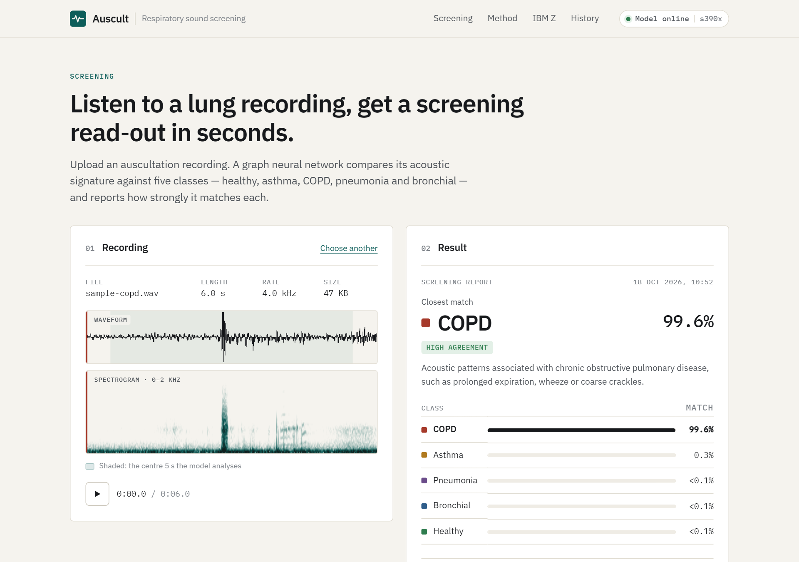
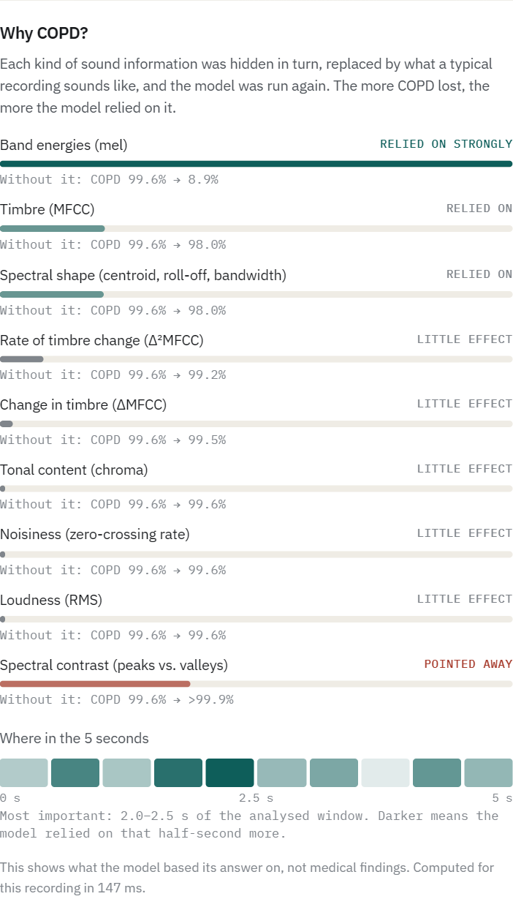
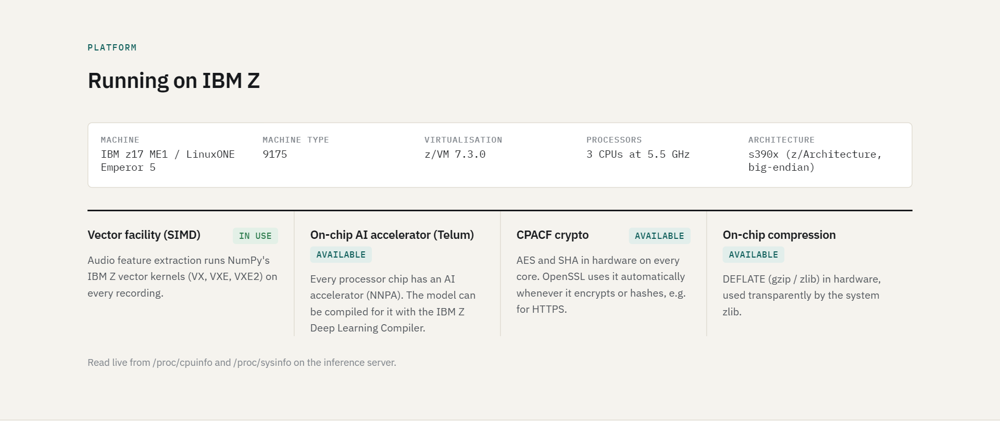
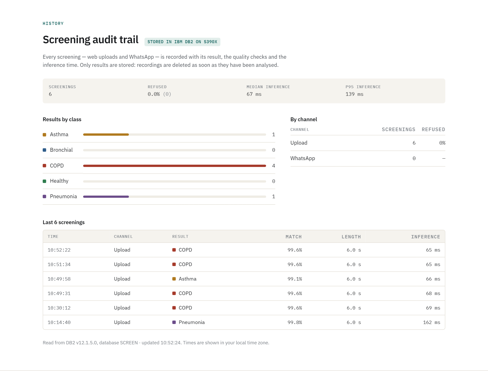
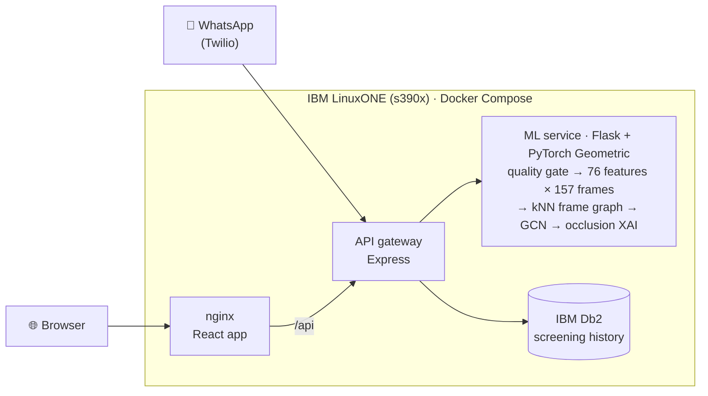

<div align="center">

# 🫁 Auscult

### Real-time, explainable lung-sound screening on IBM LinuxONE

A graph neural network listens to a 5-second stethoscope recording and screens it for
**Asthma, COPD, Pneumonia, Bronchial disease or Healthy**. It refuses recordings it can't trust,
explains every result, and keeps patient data on the machine.

**[▶ Try the live app — http://148.100.108.92/](http://148.100.108.92/)** &nbsp;·&nbsp; running on an **IBM z17 / LinuxONE Emperor 5**

     



</div>

---

## The problem

COPD caused about **3.5 million deaths in 2021**, about **262 million people** live with asthma, and
pneumonia killed about **740,000 children under five in 2019** (WHO). These diseases are often caught late.

The first test is a stethoscope: cheap and available almost everywhere. But telling a wheeze from a crackle
takes years of training, and lung specialists are scarcest where the burden is highest. Front-line health
workers need a fast, trustworthy second opinion at the point of care, without sending patient data to
outside services.

## What Auscult does

| Capability | What it means |
|---|---|
| ⚡ **Real time** | A recording is screened in **~70 ms** on IBM z17 (measured live, see below), from the web app or a **WhatsApp voice note**. |
| 🔍 **Explainable** | Every result says *why*: which kinds of sound information and which half-seconds the model relied on, and what pointed away from the result. |
| 🛡️ **Refuses to guess** | Silent, too-short or noise-only recordings are refused with a plain reason ("almost silent — place the stethoscope on the chest") instead of getting a confident wrong label. |
| 🗄️ **Auditable** | Every screening, including refusals, is recorded in **IBM Db2** on the same LinuxONE machine: results, quality checks and timing, never the audio. |
| 🔒 **Sovereign** | Audio is analysed on the LinuxONE server and deleted straight away. No public AI cloud is involved. |

> ⚠️ Auscult is a research prototype and a screening aid, **not a medical device**. A clinician must
> interpret every result together with symptoms and examination.

---

## Try it in 30 seconds

1. Open **[http://148.100.108.92/](http://148.100.108.92/)**.
2. Click an example recording (**Healthy, Asthma, COPD, Pneumonia, Bronchial**), or drop in your own WAV file.
3. Read the report: closest match, agreement level, all five probabilities, and **"Why COPD?"**.
4. Scroll to **Running on IBM Z** to see the hardware the model runs on, and **History** for the Db2 audit trail.
5. Use the **API** bar under the navigation to call each backend endpoint and see its live response.

---

## Measured on IBM LinuxONE

All figures come from the live deployment at `148.100.108.92`, reported by the app itself
(`/api/status`, `/api/history`) and by the inference service on each request.

| What | Measured |
|---|---|
| **Machine** | IBM z17 ME1 / LinuxONE Emperor 5 (machine type 9175), z/VM 7.3.0 guest, 3 CPUs at 5.5 GHz |
| **Classification** | **67 ms median, 139 ms p95** per recording (load, resample, 76 features × 157 frames, graph, GNN) |
| **Explanation** | **~150–185 ms** for all 19 "what if" variants, in one batched pass |
| **Database** | IBM Db2 12.1.5.0 for Linux on IBM Z, running beside the app |
| **On-chip** | Vector facility (VX/VXE/VXE2) in use; NNPA AI accelerator, CPACF crypto and DFLTCC compression present |

For comparison, the same model takes about 200 ms to classify and 400 ms to explain on an x86_64 laptop.

---

## 🔍 Explainable AI: why did it say COPD?



Auscult explains each result with **occlusion analysis**, computed for the exact recording and model:

1. Take one kind of acoustic information, such as the mel band energies, or one half-second of the window.
2. Replace it with what a **typical recording** looks like: the average over all 1,211 dataset recordings.
3. Run the model again and measure how much the predicted class loses.

A big drop means the result **relied on** it. A rise means it **pointed away** from the result. Drops are
measured in log-odds, so they stay meaningful even when the model is 99% sure.

In the COPD example, removing the **mel band energies** takes COPD from 99.6% to 8.9%. Spectral contrast,
on the other hand, argued *against* COPD. The timeline shows that **2.0–2.5 s** of the recording mattered most.

Each class leans on different evidence. Bronchial relies on spectral shape, Asthma on timbre (MFCC), COPD on
band energies. That is a useful check that the model isn't keying on one artefact.

The section states plainly that it shows **what the model relied on, not medical findings**. WhatsApp replies
include the top two factors.

<br clear="right">

---

## 🛡️ Trust: an input quality gate

A classifier always picks one of its classes. Before this gate, **pure silence and white noise were
labelled "Bronchial" with 99–100% confidence**. Now every recording is checked first, and refused with
HTTP 422 and a plain-language reason when it fails:

| Check | Refused when | Real recordings in the dataset |
|---|---|---|
| Length | < 0.25 s | 0.48 s – 6.0 s |
| Loudness | RMS < −60 dBFS or peak < −45 dBFS | RMS −40.4 to −2.9 dBFS |
| Noise-likeness | spectral flatness (50 Hz – 2 kHz) > 0.30 | max 0.199 (white noise: 0.40–0.57) |

The thresholds were set by measuring all **1,211** dataset recordings. **None of them is refused**, and
`evaluate_model.py` checks this on every run. The web app and WhatsApp both show the reason.

---

## 🖥️ Built for IBM Z



- **Native s390x deployment.** Web app, API gateway, AI inference and Db2 run as containers on LinuxONE.
  `deploy/deploy.sh` detects s390x and builds the IBM Z images automatically.
- **The AI stack, ported.** PyPI has no s390x wheels for the scientific Python stack, so the ML image is
  built from Debian's s390x packages and PyTorch's official s390x wheel. **numba** (needed by librosa)
  doesn't support s390x, so we wrote a NumPy stand-in, verified to give bit-identical audio features. The
  model loads correctly on big-endian IBM Z.
- **Vector SIMD in use.** Audio feature extraction runs NumPy's IBM Z vector kernels (VX, VXE, VXE2) on every
  recording. The app reads `/proc/cpuinfo` and `/proc/sysinfo` live and shows what the machine provides.
- **IBM Db2 on IBM Z** stores the audit trail (below).
- **Training on LinuxONE.** `train_on_linuxone.ipynb` trains the model in a JupyterLab container on the server,
  using the same environment as the live service, with a patient-level split.
- **Show it live.** `deploy/ibmz-showcase.sh` prints the machine, its on-chip facilities, OpenSSL AES-GCM and
  SHA-256 with and without CPACF, on-chip zlib compression, and live inference latency through the app.

## 🗄️ Audit trail in IBM Db2



Every screening, whether a web upload or WhatsApp, successful or refused, becomes one row in IBM Db2
Community Edition. A row holds the class, all five probabilities, the refusal reason and quality signals,
recording length, inference time and server architecture. **The audio is never stored.**

The History section shows counts per class, refusal rate and latency percentiles. Screening keeps working if
Db2 is starting or down: rows are then skipped, and recording resumes automatically when Db2 is back.

---

## Architecture



**From breath sound to decision:**

1. **Recording**: resampled to 16 kHz, the centre 5 s taken, peak-normalised.
2. **Quality gate**: silence, very short and noise-like audio are refused.
3. **Features**: 76 per frame × 157 frames (MFCC with Δ and Δ², spectral centroid, roll-off, contrast and
   bandwidth, zero-crossing rate, chroma, 13 mel bands, RMS).
4. **Graph**: each 32 ms frame becomes a node, linked to its 5 most similar frames (k-NN).
5. **GNN**: 4 graph-convolution layers with residual connections, batch norm, mean pooling and a 3-layer
   classifier, 58,629 parameters in all.
6. **Explanation**: 19 occluded variants classified in one batch.

---

## Model and data

**Dataset:** *Asthma Detection Dataset Version 2*, 1,211 stethoscope recordings of 1.5–6 s, built from the
Respiratory Sound Database, the ICBHI dataset and additional patients
([Tawfik et al., 2022](#dataset-citation)).

| Asthma | Bronchial | COPD | Healthy | Pneumonia |
|---:|---:|---:|---:|---:|
| 288 | 104 | 401 | 133 | 255 |

**Results of the deployed model** (`model_trained.ipynb`, 80/20 stratified split by recording):

| Class | Precision | Recall | F1 |
|---|---:|---:|---:|
| Asthma | 0.875 | 0.966 | 0.918 |
| Bronchial | 0.944 | 0.810 | 0.872 |
| COPD | 1.000 | 0.963 | 0.981 |
| Healthy | 0.931 | 1.000 | 0.964 |
| Pneumonia | 1.000 | 0.965 | 0.982 |

**Test accuracy 95.5%**, macro-F1 0.943; **5-fold cross-validation 91.0% ± 1.3%**.

> **Read these numbers carefully.** The dataset cuts each patient's audio into several short segments, and
> this split is by *recording*, so segments from the same patient can appear in both training and test sets.
> That makes the scores optimistic for new patients. `train_on_linuxone.ipynb` trains with a
> **patient-level split** for an honest estimate, and `evaluate_model.py` evaluates any model through the
> app's own inference code. For the same reason, the built-in example recordings come from the training data,
> which is why they score ~99%.

---

## API

The API bar in the app calls these live. All are served by the gateway on the same origin as the app.

| Method | Endpoint | What it does |
|---|---|---|
| `GET` | `/api/health` | Gateway liveness (used by Docker health checks) |
| `GET` | `/api/status` | Model loaded, CPU architecture, live IBM Z hardware report |
| `GET` | `/api/history?limit=N` | Recent screenings and totals from IBM Db2 |
| `POST` | `/api/upload` | Multipart `audio` WAV → probabilities, timing, explanation; `422` + reason if refused |
| `POST` | `/api/whatsapp` | Twilio webhook: screens a WhatsApp voice note and replies with the result |

```bash
curl -F "audio=@recording.wav" http://148.100.108.92/api/upload
```

---

## Run it yourself

**Any machine with Docker** (x86_64 or IBM Z):

```bash
git clone https://github.com/sanjaykumar-nb/IBM-AI-Powered-Respiratory-Disease-Detection.git
cd IBM-AI-Powered-Respiratory-Disease-Detection/respiratory-sound-classifier
docker compose up -d --build        # then open http://localhost/
```

**On an IBM LinuxONE server**, inside `respiratory-sound-classifier/`: run `sudo bash deploy/setup-server.sh` once, then
`bash deploy/deploy.sh`.
It detects s390x, generates the Db2 password, builds and starts everything, and waits until it's healthy.
See [DEPLOY.md](respiratory-sound-classifier/DEPLOY.md) for Db2, HTTPS, Jupyter training and operations.

**Test the model** in the ML environment, e.g. a JupyterLab terminal started with `deploy/jupyter.sh`:

```bash
python evaluate_model.py     # sanity tests, metrics, confusion matrix, latency, example panels
```

**Show the IBM Z hardware** in a shell on the LinuxONE server, with the app running:

```bash
bash respiratory-sound-classifier/deploy/ibmz-showcase.sh   # machine, on-chip facilities, live measurements
```

The 12 sanity tests check valid probabilities, determinism, explanations, padding, cropping and resampling,
that silence and noise are refused, and that every dataset recording passes the quality gate.

---

## Repository layout

| Path | What it is |
|---|---|
| [`respiratory-sound-classifier/`](respiratory-sound-classifier/) | The app: React frontend, Express gateway, Flask ML service, Db2, Docker Compose, deploy scripts |
| [`evaluate_model.py`](evaluate_model.py) | Sanity tests, metrics and figures through the app's own inference code |
| [`train_on_linuxone.ipynb`](train_on_linuxone.ipynb) | Training on LinuxONE with a patient-level split (`deploy/jupyter.sh`) |
| [`model_trained.ipynb`](model_trained.ipynb) | Original training notebook (features → k-NN graphs → GCN → export) |
| `Asthma Detection Dataset Version 2/` | The 1,211 training recordings |
| [`PITCH.md`](PITCH.md) | 2-minute video script and submission answers |
| `docs/screenshots/` | Screenshots of the live deployment |
| `*.mdj`, `*.docx`, `*.png` | UML diagrams, dataset description, training plots |

## Limitations and next steps

- **Patient-level validation.** Report accuracy from a patient-level split (`train_on_linuxone.ipynb`), then
  calibrate the confidence scores on held-out patients (temperature scaling).
- **NNPA acceleration.** The z17 has the Telum II AI accelerator on every chip. The next step is compiling the
  GNN (as dense matrix operations) with the free IBM Z Deep Learning Compiler.
- **HTTPS.** Serve over TLS, so CPACF hardware crypto protects audio in transit.
- **Clinical evaluation** on recordings from real point-of-care devices, beyond the curated dataset.

## Dataset citation

Tawfik, M., Al-Zidi, N. M., Fathail, I., & Nimbhore, S. (2022). *Asthma Detection System: Machine and Deep
Learning-Based Techniques.* In Artificial Intelligence and Sustainable Computing: Proceedings of ICSISCET 2021
(pp. 207–218). Springer Nature Singapore.

---

<div align="center">

**Auscult: listen, screen, refer sooner.** Built on IBM LinuxONE for the IBM Z Datathon.

</div>
